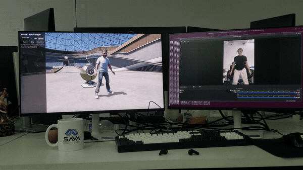
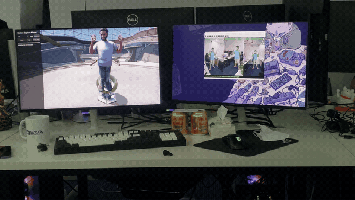

# Markerless AI Motion Capture for VR DJ & Music Video

Hệ thống **Motion Capture không marker (Markerless)** dựa trên AI, phục vụ biểu diễn DJ trong môi trường thực tế ảo (VR) và sản xuất Music Video điện ảnh. Hệ thống cho phép chuyển đổi trực tiếp chuyển động cơ thể thật của DJ thành animation cho avatar 3D/VR mà **không cần bộ đồ mocap chuyên dụng hay cảm biến/marker gắn trên người**.

---

## Tổng quan hệ thống

- **Markerless AI Tracking:** Nhận diện và tái tạo chuyển động toàn thân trực tiếp từ luồng hình ảnh camera thông thường, loại bỏ hoàn toàn sự phụ thuộc vào suit mocap hoặc marker vật lý.
- **Avatar Driving trong môi trường VR:** Chuyển hóa chuyển động của người biểu diễn thành hoạt ảnh nhân vật (avatar) tự nhiên, đáp ứng cả nhu cầu biểu diễn trực tiếp lẫn hậu kỳ điện ảnh.
- **Hỗ trợ cấu hình 1 Camera & Đa Camera (Multi-Cam):** Linh hoạt triển khai từ thiết lập gọn nhẹ với 1 camera đơn đến hệ thống nhiều camera đồng bộ cho góc quay rộng và hạn chế che khuất.

---

## Hai giai đoạn vận hành

### 1. Giai đoạn 1 — Offline (Sản xuất Music Video điện ảnh)
- Tập trung **dựng lại chuyển động với độ chính xác và độ mượt cao**.
- Phù hợp cho quy trình sản xuất Music Video, dựng cảnh 3D và hậu kỳ điện ảnh yêu cầu chất lượng animation chi tiết.

### 2. Giai đoạn 2 — Real-time (Biểu diễn DJ Live trong VR)
- Tập trung **truyền chuyển động trực tiếp (live streaming) vào môi trường VR với độ trễ cực thấp**.
- Cho phép DJ tương tác và biểu diễn theo thời gian thực thông qua avatar ngay trên sân khấu ảo.

---

## Video Demo Real-time

> Nhấn vào hình động preview hoặc liên kết bên dưới mỗi mục để mở video gốc chất lượng đầy đủ (4K MP4).

### 1. Demo Real-time 1 Camera (`1cam`)
Ghi hình thử nghiệm chế độ bắt chuyển động thời gian thực từ **1 camera đơn** và truyền trực tiếp sang avatar 3D trên Motion Capture Player.

- 🎬 **Video gốc (MP4):** [assets/1cam.mp4](./assets/1cam.mp4)

---

### 2. Demo Real-time Multi-Camera (`nhieucam`)
Ghi hình thử nghiệm chế độ bắt chuyển động thời gian thực từ **hệ thống nhiều camera (Multi-Cam)** và truyền trực tiếp sang avatar 3D trên Motion Capture Player.

- 🎬 **Video gốc (MP4):** [assets/nhieucam.mp4](./assets/nhieucam.mp4)

---
